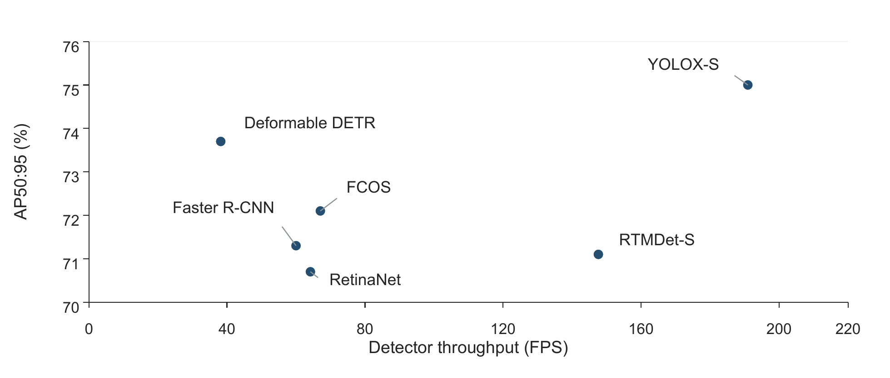
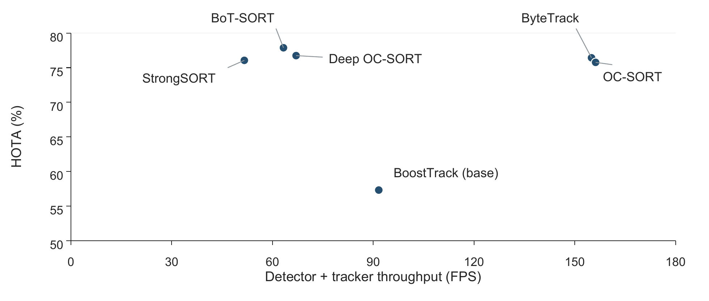

# 实验结果

正式批次`run_20261022_01`于2026年10月22日完成。数据与方法设置见[复现说明](reproduction.md)，完整数值和参数见[结果快照](../experiments/results/run_20261022_01/README.md)。

## 检测

| 方法 | AP50 % | AP50:95 % | 参数量 M | FPS |
|---|---:|---:|---:|---:|
| Faster R-CNN | 98.6 | 71.3 | 41.35 | 60.01 |
| RetinaNet | 98.5 | 70.7 | 36.33 | 64.18 |
| FCOS | 98.8 | 72.1 | 32.11 | 67.06 |
| YOLOX-S | 98.0 | 75.0 | 8.94 | 190.96 |
| RTMDet-S | 98.4 | 71.1 | 8.86 | 147.64 |
| Deformable DETR | 98.1 | 73.7 | 40.10 | 38.19 |

YOLOX-S依据验证AP50:95被选为共享检测器，测试AP50:95同样最高，为75.0%。AP50的跨度仅0.8个百分点，AP50:95跨度为4.3个百分点，严格定位指标更能区分本组结果。测速为FP32、batch=1、预热5次后20张验证图的单次测量，排除解码。

## 跟踪

| 方法 | HOTA % | IDF1 % | MOTA % | IDSW | 合成FPS |
|---|---:|---:|---:|---:|---:|
| ByteTrack | 76.43 | 96.83 | 96.07 | 1 | 154.98 |
| BoT-SORT | 77.88 | 98.06 | 96.11 | 0 | 63.28 |
| OC-SORT | 75.77 | 93.60 | 95.90 | 12 | 156.19 |
| StrongSORT online | 76.06 | 94.85 | 95.62 | 25 | 51.63 |
| Deep OC-SORT | 76.74 | 95.74 | 96.04 | 14 | 67.04 |
| BoostTrack base | 57.31 | 75.35 | 70.67 | 24 | 91.65 |

BoT-SORT相对ByteTrack的HOTA与IDF1分别高1.45和1.23个百分点；MOTA仅高0.04个百分点，同时FP增加117、FN减少145。ByteTrack的合成速度约为BoT-SORT的2.45倍。BoT-SORT虽为零ID切换，仍有35次轨迹碎片。

合成FPS由同批次检测与跟踪计算时间相加得到，包含ReID，排除解码和文件I/O。跟踪结果采用mot_clean_v1派生GT；总体指标由TrackEval合并，不能直接平均逐视频百分比。

BoostTrack基础版的FN为19955、Frag为377，主要退化表现为覆盖不足。宽高比过滤的适配问题仅为待验证线索，本轮未追加消融，也未根据测试集再次选择参数。

所有结果仅对应种子20261022与现有同场景留出，数据来源独立性尚未确认；不宣称统计显著性、跨猪场泛化或逐位复现原论文完整配置。
